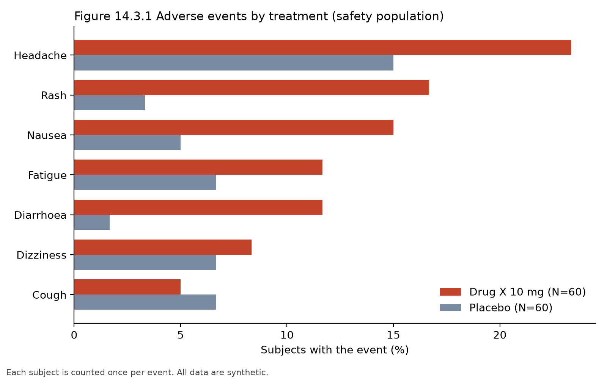

# Clinical TLF Generator

A small Python pipeline that builds standard clinical trial outputs (tables, a listing and a figure) from a synthetic trial dataset, and checks every number a second way.

## Summary

- **Data:** synthetic and invented. 120 subjects, 60 on a placebo and 60 on a made-up "Drug X 10 mg", with 82 adverse event records.
- **Outputs:** a demographics table, an adverse event summary table, an adverse event listing and an adverse event figure.
- **Checks:** 39 independent checks recompute the key numbers with plain Python and compare them with the saved outputs. All 39 pass.
- **Reproducible:** one command runs the whole pipeline twice and confirms all 9 data and output files are identical.

## What is in it

| Output | What it shows |
|---|---|
| Table 14.1.1 | Demographics and baseline characteristics by treatment (age, weight, sex, race) |
| Table 14.3.1 | Subjects with adverse events by system organ class and preferred term |
| Listing 16.2.7 | Every adverse event as its own row, sorted by treatment, subject and start day |
| Figure 14.3.1 | Most common adverse events by treatment, as percent of subjects |

Each table is saved as CSV and HTML in `outputs/`. The figure is `outputs/figure_ae.png`.



## Results from the synthetic data

| Adverse event | Placebo (N=60) | Drug X 10 mg (N=60) |
|---|---|---|
| Any adverse event | 23 (38.3%) | 39 (65.0%) |
| Headache | 9 (15.0%) | 14 (23.3%) |
| Rash | 2 (3.3%) | 10 (16.7%) |
| Nausea | 3 (5.0%) | 9 (15.0%) |
| Diarrhoea | 1 (1.7%) | 7 (11.7%) |
| Fatigue | 4 (6.7%) | 7 (11.7%) |
| Dizziness | 4 (6.7%) | 5 (8.3%) |
| Cough | 4 (6.7%) | 3 (5.0%) |

Subjects are counted once per event, even with repeat events. These numbers describe the invented dataset. They say nothing about any real drug.

## How the numbers are checked

- `src/verify_tlfs.py` recounts subjects, sex, race and adverse event numbers with plain Python (no pandas) and compares them with the saved tables, the listing and the figure file.
- The checker was tested by changing one number in a table on purpose. It reported a failure (38 of 39 checks pass) until the file was rebuilt.
- `src/run_all.py` runs every step twice and compares a fingerprint of all files, so any change between runs would be flagged.

## Limitations

- The data is synthetic. I built the dataset so that the made-up drug causes more rash and nausea, so those differences are designed in. The other differences come from chance.
- With 60 subjects per arm, small differences between arms are not reliable. This project does not run any significance tests.
- The datasets are ADSL-style and ADAE-style but simplified. They are not fully CDISC ADaM conformant.
- Adverse event names are MedDRA-style words I typed, not coded with MedDRA.
- Outputs are CSV, HTML and PNG. They are not the RTF or PDF formats used in real submissions.
- The tables cover a safety population only. There are no efficacy outputs.

## Reproducing

```
git clone https://github.com/rajnomani/clinical-tlf-generator.git
cd clinical-tlf-generator
python3 -m venv .venv
source .venv/bin/activate
pip install -r requirements.txt
python src/run_all.py
```

## Project files

| File | Purpose |
|---|---|
| `src/make_data.py` | Creates the synthetic subject and adverse event data |
| `src/table_demographics.py` | Table 14.1.1 |
| `src/table_ae_summary.py` | Table 14.3.1 |
| `src/listing_ae.py` | Listing 16.2.7 |
| `src/figure_ae.py` | Figure 14.3.1 |
| `src/verify_tlfs.py` | Independent checks |
| `src/run_all.py` | Runs everything twice and compares the results |

## Data source

None. All data is invented by `src/make_data.py`. This project is for learning and portfolio purposes and is not medical advice.

## License

MIT